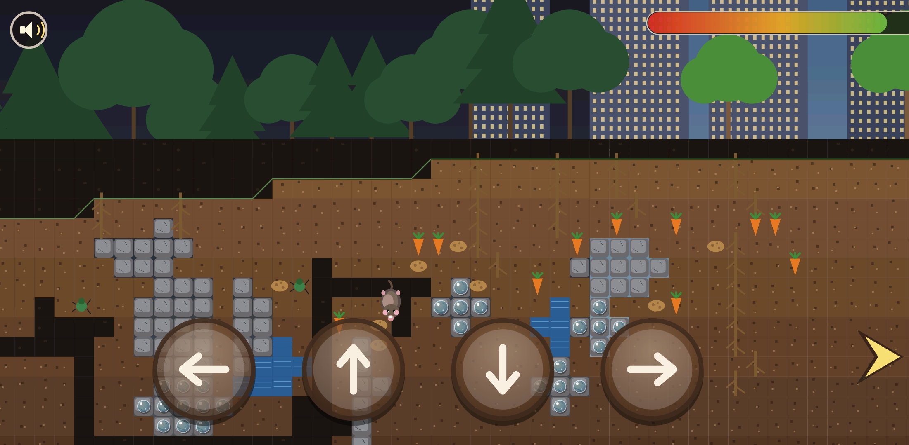

# Mole Game (molegame.apk)

A landscape Android digging game for kids. You are a mole who starts in the earth on the left 
and tunnels right towards our friend the mouse. 
The scenery above changes on the way: dark forest, then a city park, then open countryside with corn.

## Screenshot

## Run it

Install the ready-made debug build:

    adb install -r molegame.apk

Then open "Mole Game".

## Rebuild

Requires JDK 17 and an Android SDK with platform 34 (`ANDROID_HOME` set).

    ./gradlew assembleDebug

Output: `app/build/outputs/apk/debug/molegame.apk` (also copied to `./molegame.apk`).
The build is a debug build, so it is signed with your local debug key automatically.

## Controls

Four round buttons in a row at the bottom of the screen: **left**, **up**, **down** and
**right**. Each button steers in exactly one direction. There is no auto-steering.

* **Right** digs right. When rock, diamond or water blocks the mole he stops there and
  pushes against it. Nothing steers around the obstacle for you, so dig around it yourself.
  You can also press **left** to back out of a dead end.
* **Up / Down** move one row up or down. Use them to line up on a clear row, to grab food,
  and to get past obstacles.
* **Tap the play area** (above the buttons) to pause. "PAUSED" appears and the music stops;
  tap again to continue. Leaving the app pauses it too.
* **Speaker button, top left** (tap it, not the play area): turns the background music on
  and off. A red slash means muted.
* After the party, tap to start a new level.

The mole cannot dig out of the ground: he stays at or below the surface line, so the
scenery above (forest, park, corn field) is decoration only. A blinking arrow at the right
edge points towards the mouse.

## Goal

Dig to the mouse waiting in her hole near the right hand side. Digging costs power, shown by
the plain red/green bar in the top right (no labels or numbers). Food is deliberately scarce
- roots, carrots, potatoes and bugs have to be sought out, because one full charge is not
enough to finish a level. Rock, diamonds (drawn as blue spheres) and water cannot be dug
through. If the bar does run empty the mole takes a short snack break ("Zzz...") and carries
on, so there is no losing - just a pause of a couple of seconds. Reaching any tile of the
mouse hole wins, and the win screen is a confetti party; tap it to start a fresh level.

## Layout

    app/src/main/java/com/example/molegame/
      C.java            tile ids and tuning constants
      World.java        procedural level, solvability guarantee, scenery data
      Renderer.java     sky, scenery, soil, obstacles, collectibles
      Mole.java         the player character
      MouseFriend.java  the finish character
      Hud.java          power bar, banners, speaker button
      PadView.java      the four round steering buttons
      GameView.java     game loop, movement rules, camera, pause, confetti
      Music.java        background tune from res/raw/music.wav
      MainActivity.java full-screen landscape entry point
    app/src/main/res/
      raw/music.wav     background music
      values/           colours, strings, theme
      mipmap-*/         launcher icons

## About

Made with joy and Prime Agent using Deepseek Flash. 
This is a "Zero Code" project fully generated by AI. You can hire me.
